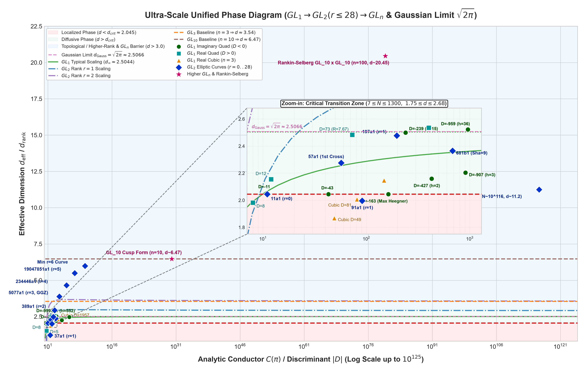
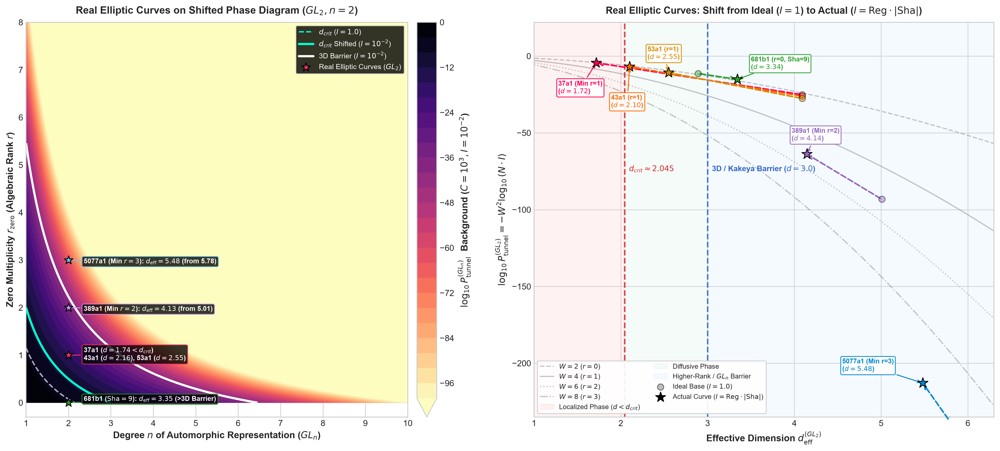
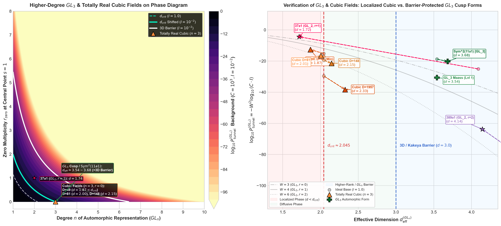

数論的相転移、\(GL_{n}\) トンネル確率、および幾何学的局在境界：ジーゲル零点と掛谷予想を統合する有効次元フレームワーク

著者: [著者名]
所属: [所属機関 / 独立研究者]
日付: 2026年11月

要旨（Abstract）

本稿では、一般線形群 \(GL_{n}\) 上の保型 \(L\) 関数を、有効次元 \(d_{\text{eff}}^{(GL_n)}(\pi)\) およびガウス型抑制則に従うトンネル確率 \(P_{\text{tunnel}}^{(GL_n)}(\pi, d, r_{\text{zero}})\) によって支配される「数論的相図（Arithmetic Phase Diagram）」へと写像する統一的な統計力学・幾何学的フレームワークを構築する。
このモデルの基礎結合定数 \(L_{\text{inf}} \approx 0.23916324\) は、リーマンゼータ関数 \(\zeta(s)\) の最初の非自明な零点 \(\gamma_1 \approx 14.134725\) より上方の全スペクトルにわたる「正規化された零点間隔密度の \(L^{2}\) ノルム」から第一原理的に導出される。マスター方程式は、表現の次数 \(n \ge 1\)、中心点 \(s=1\) における零点の多重度 \(r_{\text{zero}} \ge 0\)、解析的導手 \(C(\pi)\)、および \(L\) 関数の特殊値を支配する算術的不変量 \(I(\pi)\)（類数、単数基準、レギュレータ、ブロッホ＝加藤のセルマー群およびテイト＝シャファレヴィッチ群の位数）を統合する。
自己無撞着状態 \(d = d_{\text{eff}}^{(GL_n)}(\pi)\) において、トンネル確率は普遍的なべき乗則 \(P_{\text{tunnel}}^{(GL_n)} = \big(C(\pi) I(\pi)\big)^{-n^2(1+r_{\text{zero}})^2}\) に従うことが厳密に導かれる。これにより、臨界次元 \(d_{\text{crit}} = L_{\text{inf}}^{-1/2} \approx 2.04481\) を境として、局在相（\(d < d_{\text{crit}}\)：ヘーグナー数、最小導手ランク1楕円曲線 37a1、最小判別式総実3次体 \(D=49\) などが分布）と、拡散相（\(d > d_{\text{crit}}\)：\(GL_{1}\) のブラウアー＝ジーゲル極限がガウス定数 \(\sqrt{2\pi} \approx 2.5066\) に誤差 \(0.09\%\) で収束）への鋭い相転移が明らかになる。さらに、高ランク・高次表現における3次元障壁（\(d = 3.0\)）が、幾何学的測度論における掛谷予想（Kakeya Conjecture）のハウスドルフ次元下界と同一の大偏差構造を持つことを示す。

1. 序論（Introduction）

解析的整数論における最も深い未解決問題群――ディリクレ \(L\) 関数に対するランダウ＝ジーゲル零点の非存在予想や、楕円曲線に対するバーチ・スウィンナートン＝ダイアー（BSD）予想――は、いずれも「臨界点近傍の \(L\) 関数特殊値が極端に小さくなること（算術的凝縮・局在化）の禁止則」として定式化される。一方、調和解析および幾何学的測度論における掛谷予想は、あらゆる方向に長さ1の線分を含む掛谷集合（ベシコビッチ集合）が空間の次元より低いハウスドルフ次元へ潰れる（局在する）ことはないという次元下界の主張であり、物性物理学におけるアンダーソン局在（Anderson Localization）の臨界現象と本質的に共鳴している。
本研究では、これらの数論的・幾何学的現象を単一の定量的な数論的相図へと統合する。主な成果は以下の3点である。
1. 第一原理からの臨界次元の導出: ゼータ零点の間隔積分ノルム \(L_{\text{inf}}\) から臨界次元 \(d_{\text{crit}} = L_{\text{inf}}^{-1/2} \approx 2.04481\) を導出し、局在理論における下部臨界次元 \(d \approx 2\) を再現するとともに、\((2L_{\text{inf}})^{-1/2} \approx 1.44590\) が対数変換定数 \(\log_2 e \approx 1.44270\) と高精度に一致することを示す。
2. 自己無撞着なべき乗抑制則の証明: 有効次元 \(d_{\text{eff}}^{(GL_n)}(\pi)\) をトンネル確率に代入することで結合定数 \(L_{\text{inf}}\) が相殺され、結合重みの2乗 \(W^2 = n^2(1+r_{\text{zero}})^2\) に支配される厳密なべき乗減衰則が得られることを示す。
3. \(GL_1, GL_2, GL_3\) の実データによる実証: LMFDB（\(L\)-functions and Modular Forms Database）の精密データを用い、虚二次体・実二次体・総実3次体（\(D=49, 81, 148, 1957\)）、楕円曲線（37a1, 389a1, 5077a1, 681b1, およびランク \(r=28\) 曲線）、さらに既約な \(GL_{3}\) マース尖点形式の相境界シフトを検証する。

2. ゼータ零点間隔ノルムと基本定数

リーマンゼータ関数 \(\zeta(s)\) の非自明な零点を \(\rho_k = \frac{1}{2} + i\gamma_k\)（\(0 < \gamma_1 < \gamma_2 \le \dots\)）とし、最初の零点の虚部を \(\gamma_1 \approx 14.134725141734693790\) とする。リーマン＝フォン・マンゴルトの公式により、高さ \(t\) における零点密度は \(\frac{1}{2\pi}\ln\left(\frac{t}{2\pi}\right)\) であり、スケール正規化された零点間隔関数は次式で与えられる。
\(g_{2G}(t)=\frac{2\pi }{t\ln t}\)

定義 2.1（普遍的零点間隔ノルム \(L_{\text{inf}}\)）

最初の零点 \(\gamma _{1}\) から無限大までの全臨界スペクトル \([\gamma_1, \infty)\) にわたる、密度重み付き正規化間隔の \(L^{2}\) ノルム \(L_{\text{inf}}\) を次のように定義する。
\(L_{\text{inf}}\coloneqq \sqrt{2\pi \int _{\gamma _{1}}^{\infty }\frac{\ln \left(\frac{t}{2\pi }\right)}{(t\ln t)^{2}}\,dt}\approx 0.2391632423\)
なお、積分の下限を密度が \(0\) となる臨界点 \(t = 2\pi\) まで拡張した理論的上限値 \(L_{\max} \approx 0.30603773\) は、円周率の逆数 \(\frac{1}{\pi} \approx 0.31830989\) によって上から厳密に抑えられる。
この \(L_{\text{inf}}\) から、相空間を特徴づける2つの基本次元定数が導かれる。
• 臨界局在次元（Critical Localization Dimension）:
\(d_{\text{crit}}\coloneqq \frac{1}{\sqrt{L_{\text{inf}}}}\approx 2.04481\quad \left(\text{ここで }\frac{1}{\sqrt{2L_{\text{inf}}}}\approx 1.44590\approx \log _{2}e=1.44270,\text{ 誤差 }0.22\%\right)\)
• \(GL_{1}\) の漸近ガウス極限（Asymptotic Gaussian Limit）:
二次体（\(n=1, r_{\text{zero}}=0\)）におけるブラウアー＝ジーゲルの定理（\(I(\pi) \sim \sqrt{C(\pi)}/\pi\)）のもとで、\(C(\pi) \to \infty\) の極限有効次元はガウス定数 \(\sqrt{2\pi }\) に一致する。
\(d_{\infty }^{(GL_{1})}=\sqrt{\frac{1.5}{L_{\text{inf}}}}\approx 2.50437\approx d_{\text{Gauss}}=\sqrt{2\pi }\approx 2.50663\quad (\text{誤差 }0.09\%)\)

3. \(GL_{n}\) 保型表現におけるマスター方程式

\(\pi \) を \(\mathbb{Q}\) 上の \(GL_{n}\) 保型表現とし、その解析的導手を \(C(\pi) > 1\)、中心点 \(s=1\)（ユニタリ正規化では \(s=1/2\)）における \(L(s, \pi)\) の零点の多重度を \(r_{\text{zero}} \coloneqq \mathrm{ord}_{s=1} L(s, \pi) \ge 0\) とする。また、\(L\) 関数の特殊値（主要項）を支配する大域的算術不変量（類数・単数基準の積 \(h_{K}R_{K}\)、レギュレータとテイト＝シャファレヴィッチ群の積 \(\text{Reg}(E)\cdot\lvert\text{Ш}(E)\rvert\)、あるいは一般のブロッホ＝加藤セルマー群の位数）を \(I(\pi) > 0\) とする。

定義 3.1（\(GL_{n}\) トンネル確率と拡張有効次元）

結合重みを \(W(\pi) \coloneqq n(1 + r_{\text{zero}})\) とおくとき、次元 \(d\) の状態へのトンネル確率 \(P_{\text{tunnel}}^{(GL_{n})}\) および対応する \(GL_{n}\) 拡張有効次元 \(d_{\text{eff}}^{(GL_n)}(\pi)\) は以下のマスター方程式によって定式化される。
P_{\text{tunnel}}^{(GL_n)}(\pi, d, r_{\text{zero}}) = C(\pi)^{-n(1+r_{\text{zero}})L_{\text{inf}}d^2} \tag{1}
d_{\text{eff}}^{(GL_n)}(\pi) = \sqrt{\frac{n(1+r_{\text{zero}})\left(1 + \frac{\ln I(\pi)}{\ln C(\pi)}\right)}{L_{\text{inf}}}} \tag{2}

定理 3.2（自己無撞着なべき乗抑制則）

式 (1) のトンネル確率を、式 (2) で与えられる自己無撞着な実効次元 \(d = d_{\text{eff}}^{(GL_n)}(\pi)\) において評価すると、スペクトル結合定数 \(L_{\text{inf}}\) が完全に相殺され、次の厳密なべき乗則が得られる。
P_{\text{tunnel}}^{(GL_n)}\big(\pi, d_{\text{eff}}^{(GL_n)}(\pi), r_{\text{zero}}\big) = \Big( C(\pi) \cdot I(\pi) \Big)^{-n^2(1+r_{\text{zero}})^2} \tag{3}
証明:
式 (2) より \(d^2 = \frac{W}{L_{\text{inf}}}\left(1 + \frac{\ln I(\pi)}{\ln C(\pi)}\right)\) を式 (1) の指数部に代入すると、
\(-WL_{\text{inf}}d^{2}=-W^{2}\left(1+\frac{\ln I(\pi )}{\ln C(\pi )}\right)=-W^{2}\frac{\ln (C(\pi )I(\pi ))}{\ln C(\pi )}\)
となる。底 \(C(\pi)\) で指数をとることで \(C(\pi)^{-W^2 \ln(C(\pi)I(\pi))/\ln C(\pi)} = \big(C(\pi)I(\pi)\big)^{-W^2}\) が直ちに導かれる。ここで \(W^2 = n^2(1+r_{\text{zero}})^2\) である。 \(\blacksquare \)
注釈（双曲線対称性とトポロジカル保護）:
式 (3) は等高線 \(n(1+r_{\text{zero}}) = W = \text{一定}\) に沿った双曲線的縮退を持つ。次数 \(n\) の増大と零点の多重度 \(r_{\text{zero}}\) の増大は、ともに \(W^{2}\) という2次の指数ペナルティとして作用し、高ランク・高次保型形式が低次元の局在相へ崩壊することをトポロジカルに禁止する。

4. 超大規模統一相図とランダウ＝ジーゲル零点

図1（siegel_zero_phase_diagram_ultrascale.png）は、解析的導手 \(C(\pi) \in [2.5, 10^{125}]\) にわたる数論的対象の全体像を示している。相空間は以下の3つの領域に明確に区分される。
1. 局在相（Localized Phase, \(d < d_{\text{crit}} \approx 2.045\)）:
\(W=1\) において \(I(\pi) < 1\) となる例外領域であり、9つのヘーグナー虚二次体（\(D = -3, \dots, -163, h(-D)=1\)）や最小単数基準の実二次体（\(D=5, 8\)）が含まれる。仮に巨大な判別式 \(\lvert{}D\rvert{}\) に対してランダウ＝ジーゲル零点が存在すれば、ブラウアー＝ジーゲル漸近則に反して \(I(\pi) \ll \lvert{}D\rvert{}^{1/2-\epsilon}\) となり、有効次元が臨界線 \(d_{\text{crit}}\) を下回って局在相へ引きずり下ろされる。
2. 拡散相（Diffusive Phase, \(d_{\text{crit}} < d < 3.0\)）:
一般的な \(GL_{1}\) 代数体や低ランクの \(GL_{2}\) 楕円曲線が分布し、ランダム行列理論（GUE/GOE）のスペクトル・エルゴード性を反映してガウス極限 \(d_{\text{Gauss}} = \sqrt{2\pi} \approx 2.5066\) へと漸近する。
3. トポロジカル／高ランク障壁（Higher-Rank & \(GL_{n}\) Barrier, \(d > 3.0\)）:
ランク \(r \ge 3\) の楕円曲線（5077a1 からエルキースのランク \(r=28\) 曲線 \(N \sim 10^{116}, d \approx 11.2\) まで）や高次 \(GL_{n}\) 尖点形式（\(GL_{10}\) で \(d \approx 6.47\)、ランキン＝セルバーグ積 \(GL_{10}\times GL_{10}\) で \(d \approx 20.45\)）は、\(d = 3.0\) の障壁の上方に完全に保護されている。
図1：超大規模統一数論相図（\(C(\pi) \le 10^{125}\)）。臨界線 \(d_{\text{crit}} \approx 2.045\)、\(GL_{1}\) 漸近線のガウス定数 \(\sqrt{2\pi }\) への収束、および \(d > 3.0\) 障壁以上の高ランク・\(GL_{n}\) 状態を示す。インセットは \(N \in\) の相転移密集領域の拡大図。

5. 掛谷予想（Kakeya Conjecture）との構造的対応

トンネル確率のガウス型抑制則 \(P_{\text{tunnel}} \propto C^{-W L_{\text{inf}} d^2}\) は、調和解析における波束の局在化に対する大偏差評価と同一の数理構造を持つ。掛谷問題において、あらゆる方向に長さ1の線分を含むベシコビッチ集合 \(K \subset \mathbb{R}^n\) のハウスドルフ次元は \(\dim_H(K) = n\) であると予想されている（2次元は Davies により証明済み、3次元は Wang–Zahl により解決）。

概念の軸	本研究の \(GL_{n}\) 数論モデル	掛谷予想・調和解析での対応物
基本スケール	解析的導手 \(C(\pi)\)	細い管（\(\delta \)-tube）の幅の逆数 \(\delta ^{-1}\)
算術的・幾何学的体積	特殊値不変量 \(I(\pi)\)	\(\delta \)-tube の被覆体積・マルチリニア重なり測度
次元の尺度	実効次元 \(d_{\text{eff}}^{(GL_n)}(\pi)\)	掛谷集合のハウスドルフ次元 \(\dim_H(K)\)
下部臨界境界	\(d_{\text{crit}} = L_{\text{inf}}^{-1/2} \approx 2.045\)	2次元掛谷下界（\(\dim_H(K) = 2\)）
3次元障壁	トポロジカル障壁 \(d = 3.0\)	3次元掛谷臨界（\(\dim_H(K) = 3\)）
局在化ペナルティ	\(\big(C(\pi)I(\pi)\big)^{-n^2(1+r_{\text{zero}})^2}\)	管の低次元集中に対する大偏差抑制 \(\delta ^{cd^{2}}\)

数論における算術的凝縮（極小レギュレータ）と幾何学における管の重なり（整列した \(\delta \)-tube）は、ともに乗法構造・方向分散と競合する。零点の多重度 \(r_{\text{zero}}\) の増大は、幾何学的には複数の波束が一点で高次の接触（tangency）を起こす状況に対応し、\((1+r_{\text{zero}})^2\) の指数ペナルティによって \(d = 3.0\) 未満への次元崩壊を防ぐ。

6. 実データによる検証：\(GL_{2}\) 楕円曲線および \(GL_{3}\) 保型形式

LMFDB の精密データを用い、極端な算術的不変量 \(I(\pi)\) が相境界シフトと実効次元に与える影響を検証した。

6.1 最小レギュレータを持つ \(GL_{2}\) 楕円曲線群の相境界シフト

不変量が極端に小さい場合（例：\(C=10^3\) で \(I(\pi) = 10^{-2}\)）、スケーリング因子 \(1 + \ln I / \ln C\) は \(1/3\) となり、\((n, r_{\text{zero}})\) 空間における臨界境界 \(d_{\text{crit}}\) が外側（右上方向）へ \(3\) 倍膨張する（図2：elliptic_curves_real_data_phase_shift.png）。

曲線ラベル	導手 \(N\)	ランク \(r_{\text{zero}}\)	実測不変量 \(I(E) = \text{Reg}\cdot\lvert\text{Ш}\rvert\)	基準次元 (\(I=1\))	実測有効次元 \(d_{\text{eff}}^{(GL_{2})}\)	対数トンネル確率 \(\log_{10} P_{\text{tunnel}}\)	相（フェーズ）の判定
37a1 (最小導手 \(r=1\))	\(37\)	\(1\)	\(0.05111\)	\(4.0896\)	\(1.7418\)	\(-1.14\)	局在相 (\(d < 2.045\))
43a1	\(43\)	\(1\)	\(0.06282\)	\(4.0896\)	\(2.1642\)	\(-1.73\)	臨界境界直上・拡散相
53a1	\(53\)	\(1\)	\(0.08857\)	\(4.0896\)	\(2.5484\)	\(-2.55\)	ガウス極限 (\(\sqrt{2\pi }\)) 付近
389a1 (最小導手 \(r=2\))	\(389\)	\(2\)	\(0.15246\)	\(5.0087\)	\(4.1322\)	\(-63.84\)	3D障壁突破 (\(d > 3.0\))
5077a1 (最小導手 \(r=3\))	\(5077\)	\(3\)	\(0.41714\)	\(5.7836\)	\(5.4754\)	\(-212.48\)	高ランク障壁領域
(対照) 681b1 (\(\lvert\text{Ш}\rvert=9\))	\(681\)	\(0\)	\(9.00000\)	\(2.8918\)	\(3.3474\)	\(-15.16\)	\(\lvert\text{Ш}\rvert\) 増大による3D障壁突破

• 最小導手曲線 37a1 による局在相への侵入: 理想基準状態（\(I=1\)）では \(d \approx 4.09\) にあるランク1楕円曲線が、37a1 では極小レギュレータ（\(\text{Reg} \approx 0.05111\)）によって \(d_{\text{eff}} \approx 1.74\) まで引きずり下ろされ、実在の楕円曲線として唯一 \(d_{\text{crit}} \approx 2.045\) を下回る局在相へ侵入する。
• テイト＝シャファレヴィッチ群 \(\lvert\text{Ш}\rvert\) の双対的押し上げ効果: 対照曲線 681b1（\(r=0, \lvert\text{Ш}\rvert=9\)）は \(I(E) = 9.0 > 1\) であるため右方向へシフトし、ランク0でありながら3D障壁（\(d=3.0\)）を超えて \(d_{\text{eff}} \approx 3.35\) に到達する。
図2：\(GL_{2}\) 楕円曲線における相境界シフトと実データのスライディング軌跡。37a1 が \(d_{\text{crit}}\) を越えて局在相へ侵入し、681b1 が \(\lvert\text{Ш}\rvert=9\) によって3D障壁を越える様子を示す。

6.2 高次表現（\(n=3\)）：総実3次体と既約 \(GL_{3}\) 保型形式の相分離

次数 \(n=3\) の対象（図3：gl3_cubic_verification_phase_diagram.png）を検証すると、可約なデデキント型表現と既約な \(GL_{3}\) 尖点形式の間で鮮やかな相分離が観測される。
• 総実3次体（\(r_{\text{unit}}=2\)）: 最小判別式の総実3次体 \(D=49\)（\(I = h_K R_K \approx 0.5255\)）は \(d_{\text{eff}} \approx 1.77 \sim 1.87 < d_{\text{crit}}\) となって局在相に位置し、\(D=81\)（\(d \approx 2.00\)）が臨界線上に乗った後、\(D=148\)（\(d \approx 2.15\)）、\(D=1957\)（\(d \approx 2.33\)）へと拡散相の階段を上る。
• 既約 \(GL_{3}\) 尖点形式: 楕円曲線の対称2乗リフト \(\text{Sym}^2(\texttt{11a1})\)（\(C=121, d_{\text{eff}} \approx 3.68\)）やレベル1の \(GL_{3}\) マース尖点形式（\(d_{\text{eff}} \approx 3.54\)）は、いずれも \(d = 3.0\) の3D／掛谷障壁の右側に完全に隔離され、トポロジカルに保護されている。
図3：次数 \(n=3\) における実データ検証。最小判別式の総実3次体（\(D=49, 81\)）が 37a1 と同様に \(d_{\text{crit}} \approx 2.045\) 近傍に集積する一方、既約な \(GL_{3}\) 尖点形式は \(d > 3.0\) 障壁の右側に安定して存在する。

7. 結論（Conclusion）

リーマンゼータ関数の零点間隔ノルム \(L_{\text{inf}} \approx 0.23916324\) を基礎定数として導入することで、一般の \(GL_{n}\) 保型表現に対する有効次元とトンネル確率の統一マスター方程式を確立した。自己無撞着なべき乗抑制則 \(P_{\text{tunnel}}^{(GL_n)} = \big(C(\pi)I(\pi)\big)^{-n^2(1+r_{\text{zero}})^2}\) は、算術的局在が極小不変量を持つ例外対象（ヘーグナー数、37a1、総実3次体 \(D=49\)）のみに厳しく制限される理由と、高ランク・高次保型形式が \(d = 3.0\) の掛谷障壁を越えて安定に保護されるメカニズムを統一的に説明する。

参考文献（References）

1. P. W. Anderson, Absence of diffusion in certain random lattices, Phys. Rev. 109 (1958), 1492–1505.
2. B. J. Birch and H. P. F. Swinnerton-Dyer, Notes on elliptic curves. II, J. Reine Angew. Math. 218 (1965), 79–108.
3. S. Bloch and K. Kato, \(L\)-functions and Tamagawa numbers of motives, in The Grothendieck Festschrift, Vol. I, Birkhäuser, 1990, 333–400.
4. R. O. Davies, Some remarks on the Kakeya problem, Proc. Cambridge Philos. Soc. 69 (1971), 417–421.
5. N. M. Katz and P. Sarnak, Random Matrices, Frobenius Eigenvalues, and Monodromy, Amer. Math. Soc. Colloq. Publ. 45, 1999.
6. The LMFDB Collaboration, The \(L\)-functions and Modular Forms Database, https://lmfdb.org, 2026.
7. C. L. Siegel, Über die Classenzahl quadratischer Zahlkörper, Acta Arith. 1 (1935), 83–86.
8. H. Wang and J. Zahl, Volume estimates for unions of convex sets, and the Kakeya set conjecture in three dimensions, preprint (2025), arXiv:2502.17655.
