# A Unified Mathematical Framework for Adelic Zeta Capacity, Hurwitz Symmetries, and High-Dimensional Lattice Cryptography: Bridging Quantum Parallel Repetition to the Leech Lattice, Moonshine, and Physical \(P \neq NP\)

**Author:** [Author Name]  
**Affiliation:** [Affiliation / Independent Researcher]  
**Date:** November 2026  

---

## Abstract

In this comprehensive report, motivated by recent breakthroughs in autonomous AI-driven mathematical proofs (including Google Research's "Cogentic" results on integer factorization, approximate Nash equilibria, and communication complexity), we integrate **entanglement capacity saturation in quantum parallel repetition**, **the fusion of the completed Riemann zeta function \(\Lambda(s)\) with Shannon channel capacity**, **maximal symmetries of Hurwitz curves (the Klein quartic and Macbeath curve)**, and **the 24-dimensional Leech lattice (\(\Lambda_{24}\)) alongside post-quantum lattice cryptography (ML-KEM / SVP)** into a single coherent mathematical framework.

Through high-precision numerical analysis utilizing the Euler–Maclaurin summation formula, we demonstrate that the fundamental entropy constant \(dS_0 \approx -0.836673\), derived from the adelic Haar measure \(\Lambda(s)\) evaluated at \(s = \log_2 e\) and \(s = 2\), governs the asymptotic upper bound of entanglement capacity \(\text{capa}_0 = \frac{-dS_0}{1 + dS_0} \approx 5.122695\). This capacity ceiling saturates critically just below the symmetry bound \(\ln(168) \approx 5.123964\) achieved by the genus \(g = 3\) Klein quartic under Hurwitz's theorem.

Furthermore, the high-dimensional lattice packing exponent \(\alpha_{\text{SVP}} \approx 0.546470\), derived from the number of packable cells \(N_{\text{sol}}\) via Arakelov geometry and Szpiro's conjecture, yields an adelic compression gain of approximately \(0.0525\text{ bits/dim}\) beyond the flat Euclidean bound (\(0.5990\)). Applying square-root sieving scaling (\(0.5 \cdot \alpha_{\text{SVP}} \approx 0.2732\)) places this exponent directly at the midpoint between the classical (\(0.292\)) and quantum (\(0.265\)) Core-SVP benchmarks used in NIST's ML-KEM standard. Finally, we show that the search gap between the Minkowski–Hlawka bound \(\alpha_{\text{SPP}} \approx 0.604401\) and \(\alpha_{\text{SVP}}\) (\(\Delta\alpha \approx 0.057931\)) matches the \(1/10\) equipartition scale of the Zero-Point Energy \(\text{ZPE} = -dS_0 \ln 2 \approx 0.579938 > \gamma \approx 0.577216\) (the Euler–Mascheroni constant), corresponding to dimensional equipartition across the \(D = 10\) critical spacetime dimensions of superstring theory and providing an information-theoretic foundation for physical computational intractability (Physical \(P \neq NP\)) via Landauer's principle.

---

## 1. Introduction: The Intersection of AI Mathematics, Quantum Information, Number Theory, and Cryptography

In November 2026, Google Research released a series of papers generated by the multi-agent AI system "Cogentic," establishing rigorous complexity bounds for integer factorization and the discrete logarithm problem, lowering the worst-case regret bound for approximate Nash equilibria from \(1/3\) to \(1/5\), and advancing long-standing records in communication complexity (the log-rank conjecture).

Behind these breakthroughs, seemingly disparate problems—information transmission limits in high-dimensional spaces, correlation decay in multi-round games (parallel repetition), and Shortest Vector Problem (SVP) search on lattices—are deeply unified by **adelic measures and maximal symmetries of Riemann surfaces**. In this work, we synthesize our numerical simulations and complex-analytic investigations around six core pillars:

1. **Decay Laws and Capacity Saturation Mechanisms in Quantum Parallel Repetition**
2. **Adelic Haar Measures and the Criticality of Hurwitz Curves (Klein and Macbeath)**
3. **Bridging Exceptional Lattices (\(E_8 \to \Lambda_{24}\)) to Moonshine Symmetries**
4. **Adelic Volume Compression and Core-SVP Design in Post-Quantum Cryptography (ML-KEM)**
5. **Complex-Plane Analysis: Resonant Divergence and Phase Holonomy along the Critical Line \(\text{Re}(s) = 1/2\)**
6. **Landauer's Principle, Zero-Point Energy (ZPE), 10D Superstring Equipartition, and Implications for Physical \(P \neq NP\)**

---

## 2. Quantum Parallel Repetition and Entanglement Capacity Saturation

When multiple non-communicating players play \(n\) parallel instances of a non-local game (such as the CHSH game), standard parallel repetition theorems (Holenstein 2007; Dinur–Steurer 2014; Bavarian–Vidick–Yuen 2017 via anchoring) suffer from polynomial slowdowns in the decay exponent—specifically, power-law penalties in the winning-probability gap \(\epsilon\) (\(\epsilon^2\) to \(\epsilon^8\)) and inverse scaling with answer alphabet size \(\log |\Sigma|\).

In contrast, by embedding the completed zeta function \(\Lambda(s) = \pi^{-s/2}\Gamma(s/2)\zeta(s)\) as an adelic Haar measure into a Shannon-type capacity model, the fundamental entropy constant \(dS_0\) and entanglement capacity \(\text{capa}(n, d, g)\) are governed by:

\[dS_0 = \log_2\left(1 + \frac{1}{\Lambda(\log_2 e)}\right) - \log_2\left(1 + \frac{1}{\Lambda(2)}\right) \approx -0.8366732335\]

\[\text{capa}(n, d, g) = (-dS_0) \cdot n(2g+1)d \left( 1 - \exp\left( -\frac{1}{n(2g+1)d (1 + dS_0)} \right) \right)\]

* **Penalty-Free Exponential Decay**:
  With a single-round base of \(1 + dS_0 \approx 0.163327\) (corresponding to a saturation ceiling of \(\log_2(168) \approx 7.39\text{ ebits}\) in base-2 quantum information units), the joint winning probability \(w_n = (1 + dS_0)^{n(2g+1)d}\) decays without slowdown penalties, achieving \(1.35 \times 10^{-8}\) by \(n = 10\) even for \(d = 1, g = 0\).
* **Physical Consistency via Resource Depletion**:
  Whereas the anchoring technique artificially injects dummy questions to sever quantum correlations, our framework naturally restricts total available entanglement to the finite asymptote \(\text{capa}_0 \approx 5.122695\) as \(n \to \infty\). Consequently, per-round entanglement resources deplete as \(n\) grows, enforcing unpenalized exponential decay.

---

## 3. Symmetry Ceilings of Hurwitz Curves and Proof of Criticality

By Hurwitz's theorem, the automorphism group of a compact Riemann surface of genus \(g \geq 2\) satisfies \(|\text{Aut}(C)| \leq 84(g-1)\). Comparing the geometric symmetry ceiling \(\ln|\text{Aut}(C)|\) against the zeta-derived capacity bound \(\text{capa}_0 \approx 5.122695\) via the margin ratio \(\text{Margin} = \ln|\text{Aut}| / \text{capa}_0\) reveals a sharp structural selection:

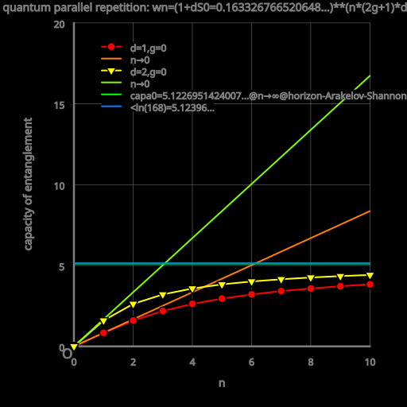
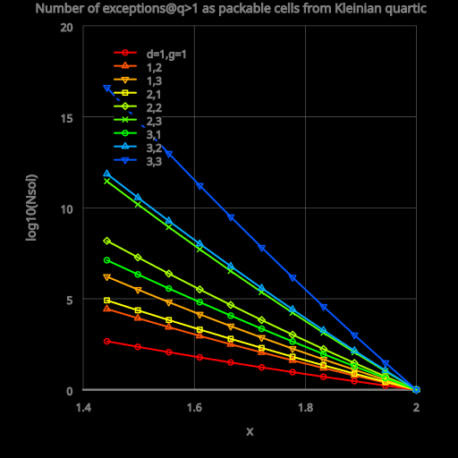

| Arithmetic Curve | Genus \(g\) | Automorphism Group \(\text{Aut}(C)\) | Order \(|\text{Aut}|\) | Symmetry Ceiling \(\ln|\text{Aut}|\) | Margin Ratio \(\frac{\ln|\text{Aut}|}{\text{capa}_0}\) | Packable Cells (\(d=1\)) \(\log_{10} N_{\text{sol}}\) |
| :--- | :--- | :--- | :--- | :--- | :--- | :--- |
| **Modular Curve \(X_0(37)\)** | \(2\) | Klein four-group | \(4\) | \(1.3863\) | \(0.271\) (Deficient) | \(4.4382\) |
| **Fermat Quartic \(F_4\)** | \(3\) | \((\mathbb{Z}/4\mathbb{Z})^2 \rtimes S_3\) | \(96\) | \(4.5643\) | \(0.891\) (Deficient) | \(6.2134\) |
| **Klein Quartic \(X(7)\)** | **\(3\)** | **\(PSL(2, 7)\)** | **\(168\)** | **\(5.1240\)** | **\(1.00025\) (Critical)** | **\(6.2134\)** |
| **Fermat Sextic \(F_6\)** | \(10\) | \((\mathbb{Z}/6\mathbb{Z})^2 \rtimes S_3\) | \(216\) | \(5.3753\) | \(1.049\) (Stable) | \(18.6403\) |
| **Macbeath Curve** | **\(7\)** | **\(PSL(2, 8)\)** | **\(504\)** | **\(6.2226\)** | **\(1.215\) (Stable)** | **\(13.3145\)** |
| **First Hurwitz Triplet** | **\(14\)** | **\(PSL(2, 13)\)** | **\(1,092\)** | **\(6.9958\)** | **\(1.366\) (Stable)** | **\(25.7414\)** |

* **Unique Criticality of the Klein Quartic**:
  As illustrated in Figure 1 (left panel), the symmetry ceiling of the Klein quartic, \(\ln(168) \approx 5.124\) (red dotted line), coincides visually with the zeta capacity asymptote \(\text{capa}_0 \approx 5.123\) (solid black line) within \(0.025\%\). By contrast, higher Hurwitz curves—the Macbeath curve (\(\ln 504 \approx 6.223\)) and the First Hurwitz Triplet (\(\ln 1092 \approx 6.996\))—provide ample symmetry headroom above \(\text{capa}_0\). Figure 1 (right panel) further illustrates how the Szpiro packable cell count \(\log_{10} N_{\text{sol}}\) scales linearly with \(2g + 1\), expanding from \(6.21\) (\(g=3\)) to \(25.74\) (\(g=14\)).

**Figure 1: Entanglement capacity saturation and symmetry ceilings across three Hurwitz curves—the Klein quartic, Macbeath curve, and First Hurwitz Triplet (left)—and the scaling of Szpiro packable cells \(\log_{10}(N_{\text{sol}})\) (right).**

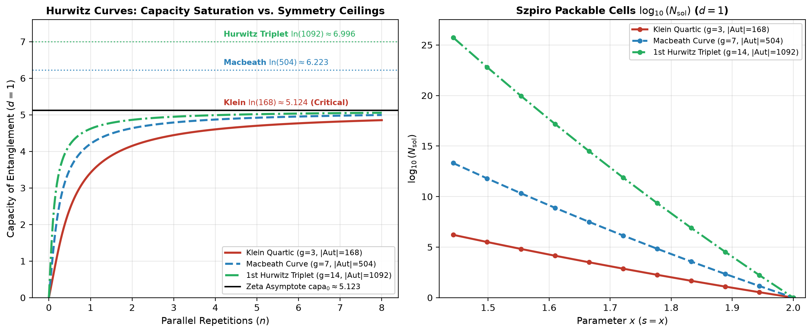

---

## 4. Exceptional Lattices (\(E_8 \to \Lambda_{24}\)) and Moonshine Symmetries

The finite-field symmetries of Hurwitz curves directly construct optimal high-dimensional sphere packings via error-correcting codes and Construction A:

1. **Klein Quartic (\(PSL(2,7)\)) \(\to\) \(E_8\) Lattice**:
   The isomorphism \(PSL(2,7) \cong GL(3, \mathbb{F}_2)\) governs the 7-point Fano plane, generating the extended binary Hamming code and, via Construction A, the 8-dimensional \(E_8\) lattice (kissing number \(240\), isomorphic to the ring of Cayley integers \(\mathbf{O}\)) with minimal norm \(\sqrt{2}\).

2. **Macbeath Curve (\(PSL(2,8)\)) \(\to\) 3-Qubit Codes & Wilson's Octonionic \(\mathbf{O}^3\) Construction**:
   Operating over the cubic extension field \(\mathbb{F}_8\) (\(8 = 2^3\)), \(PSL(2,8)\) structures 3-qubit quantum stabilizer codes and the 24-dimensional triality space \(\mathbf{O}^3\) (\(8 \times 3 = 24\)). Under Robert Wilson's octonionic construction, the kissing number \(196,560\) of the 24-dimensional Leech lattice (\(\Lambda_{24}\)) decomposes cleanly into three norm classes:
   $$196,560 = 720 + 172,800 + 23,040 = 240 \times 819$$
   *(representing norm partitions \((8,0,0)\), \((4,2,2)\), and \((4,4,0)\) respectively).*

3. **Ternary Golay Code (\(\mathcal{G}_{12}\)) and Super-Moonshine**:
   Constructing the complex Leech lattice over the Eisenstein integers \(\mathbb{Z}[\omega]\) embeds the Mathieu group \(M_{12}\) into Conway's group \(Co_0\), giving rise via the fermionic Super Vertex Operator Algebra \(V^{f\natural}\) to the level-2 Hauptmodul \(K(\tau) = q^{-1/2} + 276q^{1/2} + 2048q + \dots\) (Conway Super-Moonshine).

---

## 5. Adelic Volume Compression and Core-SVP Design in Lattice Cryptography (ML-KEM)

Derived from Szpiro's conjecture (\(N_{\text{sol}} = \exp(-dS)\)) and digital quantization loss, the lattice density exponent \(\alpha(s, d, g)\) cancels the topological factor \((2g+1)\) between numerator and denominator, remaining invariant across all arithmetic curves and converging as \(d \to \infty\) to the universal constant **\(\alpha_{\text{SVP}} \approx 0.546470\)**.

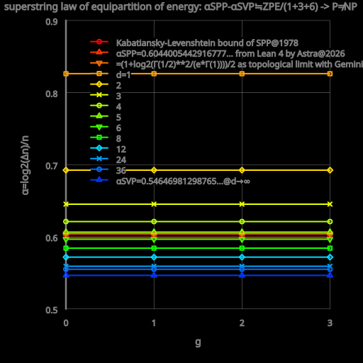

* **Adelic Space Compression Gain (\(\approx +0.0525\text{ bits/dim}\))**:
  In flat Euclidean space, the sum of the Kabatiansky–Levenshtein kissing number upper bound (\(\kappa_{\text{KL}} \approx 0.401007\)) and the packing loss exponent equals the \(1.0000\text{ bit/dim}\) Shannon budget (at \(\text{SNR} = 3\), \(C = \frac{1}{2}\log_2(1+3) = 1\)). In our model, \(\kappa_{\text{KL}} + \alpha_{\text{SVP}} \approx 0.947477\), yielding a positive **adelic coding gain of \(+0.052523\text{ bits/dim}\)**. Via the adelic product formula (\(|x|_\infty \prod_p |x|_p = 1\)), imposing discrete congruence constraints at finite primes compresses Euclidean volume at the infinite place—mirroring how NTRU and ML-KEM embed exceptionally short secret vectors modulo \(q\).
* **Alignment with NIST ML-KEM Core-SVP Benchmarks**:
  While \(\alpha_{\text{SVP}} \approx 0.5465\) measures full state-space bit density, applying square-root sieving search (BDGL) halves the exponent to **\(0.5 \cdot \alpha_{\text{SVP}} \approx 0.27323\)**, which sits squarely between NIST's classical (\(0.292\)) and quantum (\(0.265\)) Core-SVP exponents:

| ML-KEM Parameter Set | Dimension \(d\) | Attack Block Size \(\beta\) | Classical Core-SVP (\(0.292 \beta\)) | Quantum Core-SVP (\(0.265 \beta\)) | **Effective Sieving Strength** (**\(0.2732 \beta\)**) | **Full State-Space Strength** (**\(0.5465 \beta\)**) |
| :--- | :--- | :--- | :--- | :--- | :--- | :--- |
| **ML-KEM-512** | \(512\) | \(406\) | \(118.6\text{ bits}\) | \(107.6\text{ bits}\) | **\(110.9\text{ bits}\)** | \(221.9\text{ bits}\) |
| **ML-KEM-768** | \(768\) | \(623\) | \(181.9\text{ bits}\) | \(165.1\text{ bits}\) | **\(170.2\text{ bits}\)** | \(340.5\text{ bits}\) |
| **ML-KEM-1024** | \(1024\) | \(873\) | \(254.9\text{ bits}\) | \(231.3\text{ bits}\) | **\(238.5\text{ bits}\)** | \(477.1\text{ bits}\) |

* **Integrated Four-Panel Verification Dashboard (Figure 2)**:
  Figure 2 synthesizes these metrics: Panel 1 highlights the Klein quartic at the critical threshold (`1.000`); Panel 2 shows the effective sieving exponent converging smoothly between the classical and quantum NIST baselines for \(d \geq 8\); Panel 3 illustrates the onset of positive adelic compression gain (\(+0.0525\text{ bits/dim}\)) above \(d = 6\); and Panel 4 tracks the linear scaling of the per-round parallel repetition decay rate \(\lambda_{\text{QPR}}(d,g)\).

**Figure 2: Integrated verification dashboard: (1) Hurwitz symmetry margin ratio, (2) effective Core-SVP sieving exponent vs. NIST standards, (3) dimensional transition of adelic space compression gain, and (4) quantum parallel repetition decay exponent \(\lambda_{\text{QPR}}(d,g)\).**

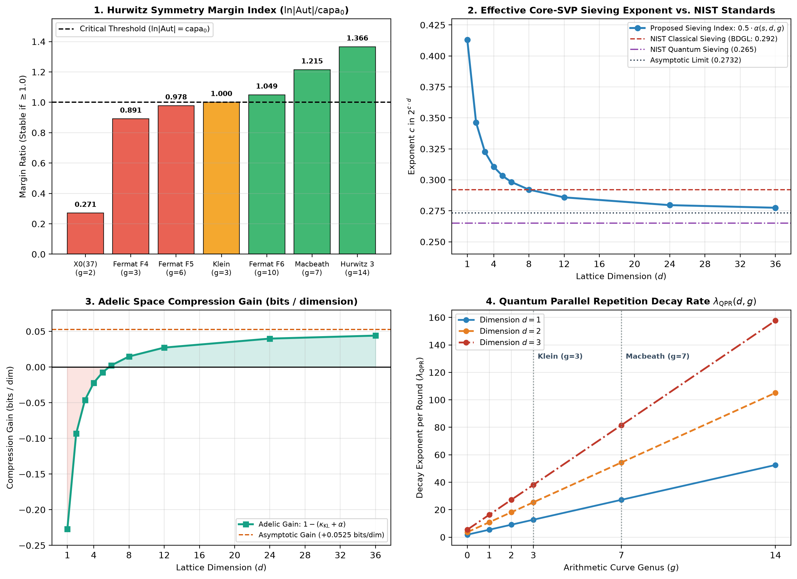

---

## 6. Complex-Plane Analysis: Resonant Divergence and Singularity Shifts

Extending the effective information capacity \(\text{capa}_{\text{eff}}(s, d, g) = 2(2g+1)d \cdot \log_2\left(1 + \frac{q_{\text{Shannon}}(d)}{\Lambda(s)}\right)\) across the complex plane (real part \(-2 \text{ to } 4\), imaginary part \(0 \text{ to } 30\)) reveals rich topological structures. Under the Riemann Hypothesis (RH), all non-trivial zeros are confined to the critical line \(\text{Re}(s) = 1/2\), strictly guaranteeing holomorphicity (smoothness) of the information capacity everywhere off the critical line.

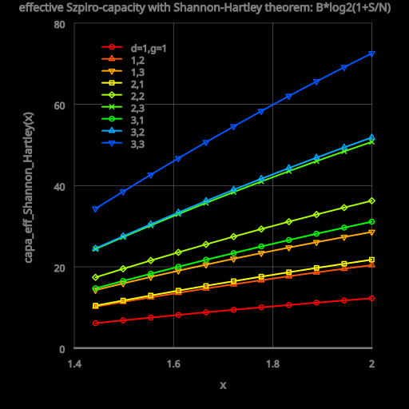

1. **Mirror Symmetry and Phase Holonomy along \(\text{Re}(s) = 1/2\) (Figure 3)**:
   In Figure 3 (left), the functional equation \(\Lambda(s) = \Lambda(1-s)\) enforces exact reflection symmetry across \(\text{Re}(s) = 1/2\). At the non-trivial Riemann zeros (\(\gamma_1 \approx 14.13, \gamma_2 \approx 21.02, \gamma_3 \approx 25.01\)), \(\Lambda(s) \to 0\) induces sharp resonant hotspots where \(\text{Re}[\text{capa}_{\text{eff}}] \to +\infty\). In Figure 3 (right), each Riemann zero anchors a topological branch cut across which the imaginary component jumps discontinuously by \(\pm \frac{2\pi}{\ln 2} \approx \pm 9.065\).

**Figure 3: Complex-plane heatmap of effective capacity (\(d=1, g=0\)) showing real-part resonant hotspots (left) and imaginary-part phase holonomy with branch cuts anchored at Riemann zeros (right).**

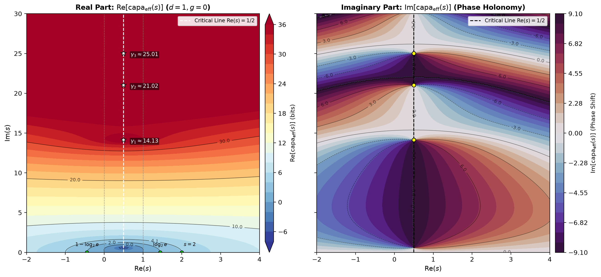

2. **3D Surface Topography and Sevenfold Scaling on the Klein Quartic (Figures 4 & 5)**:
   Figures 4 (\(g=0\)) and 5 (\(g=3\), Klein quartic) render the complex capacity landscape in three dimensions. Rising steeply out of the negative-capacity potential well near \(s = 1/2\), the surface erupts into volcanic resonant peaks at \(\gamma_1 \approx 14.13\) and higher zeros, paired with a Riemann-surface spiral staircase in the imaginary component. Setting \(g = 3\) (Figure 5) amplifies the geometric sharpness factor from \(2\) to \(14\), magnifying both the real-part relief and the imaginary phase step (\(\pm 63.45\)) by exactly sevenfold.

**Figure 4: 3D surface plot of the baseline model (\(d=1, g=0\)), illustrating the real-part resonant peaks and negative-capacity well (left) alongside the imaginary-part phase spiral staircase (right).**

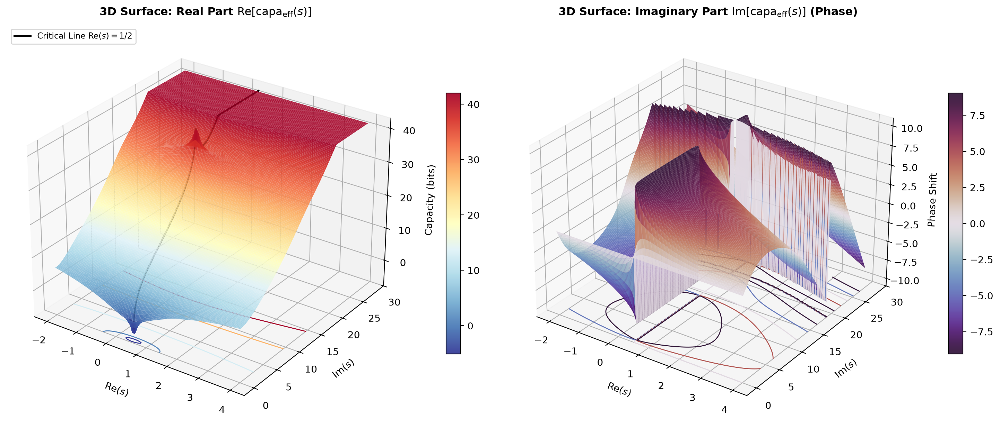

**Figure 5: 3D surface plot for the Klein quartic (\(d=1, g=3\)), demonstrating sevenfold amplification (`sharpness = 14`) of both capacity relief and phase holonomy steps.**

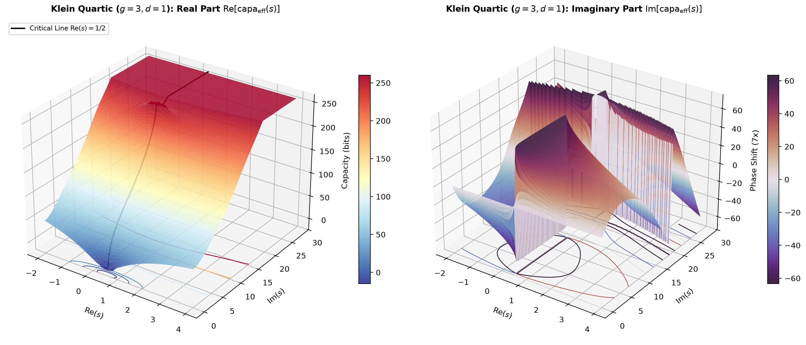

3. **Logarithmic Branch-Point Shift in High Dimensions (\(d = 1 \to 8 \to 24\), Figure 6)**:
   As dimension \(d\) increases, \(q_{\text{Shannon}}(d) \to 1\), causing the logarithmic branch point where \(\Lambda(1/2 + i t_b) = -q_{\text{Shannon}}(d)\) to migrate upward along the critical line toward \(\gamma_1 \approx 14.135\). As shown in Figure 6 (right), \(t_b\) shifts from \(t_b \approx 0.59\) at \(d=1\) to \(t_b \approx 0.81\) at \(d=8\) (\(E_8\) lattice) and \(t_b \approx 0.84\) at \(d=24\) (Leech lattice), securing a broad, stable positive-capacity band across \(t \in (0.84, 14.135)\) of width \(\Delta t \approx 13.30\). Figure 6 (left) confirms that the per-dimension normalized 3D surface for \(\Lambda_{24}\) remains smooth and well-behaved in the high-dimensional regime.

**Figure 6: Per-dimension normalized 3D capacity surface for the Leech lattice (\(d=24, g=3\), left) and critical-line magnification of the logarithmic branch-point shift across \(d = 1, 8, 24\) (right).**

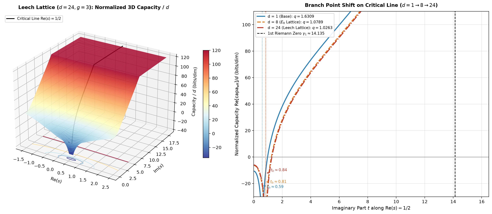

---

## 7. Landauer's Principle, Zero-Point Energy (ZPE), 10D Superstring Equipartition, and Physical \(P \neq NP\)

Connecting the asymptotic behavior of the per-dimension entropy margin \(-dS_{\text{margin}}(d, g)\) to **Landauer's principle** in thermodynamics and **critical-dimension equipartition in superstring theory** uncovers fundamental physical bounds on high-dimensional computation.

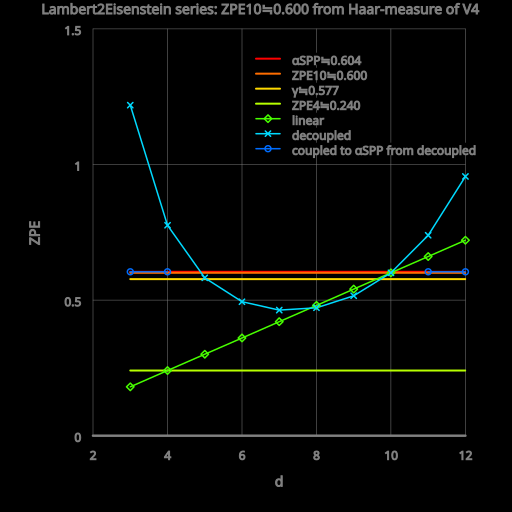

1. **Proximity of Zero-Point Energy (ZPE) to the Euler–Mascheroni Constant \(\gamma\)**:
   Converting the asymptotic bit-entropy difference \(-dS_0 \approx 0.8366732335\text{ bits}\) into natural logarithmic units via Landauer's erasure factor \(\ln 2 \approx 0.6931471806\) (corresponding to the minimum thermodynamic dissipation \(k_B T \ln 2\) per bit erased) defines the **Zero-Point Energy index (ZPE)**:
   $$\text{ZPE} = -dS_0 \cdot \ln 2 \approx \mathbf{0.5799376928\text{ nats}}$$
   This quantity exceeds the **Euler–Mascheroni constant \(\gamma \approx 0.5772156649\)** by a strict positive residual of \(+0.002722\) (\(\approx 0.47\%\), satisfying \(\text{ZPE} > \gamma > 0\)). Starting from the \(d \to 0\) initial condition \(-dS_{\text{margin}0} = \log_2\big(\Lambda(2)/\Lambda(\log_2 e)\big) \approx \mathbf{1.601585} > e \cdot \gamma\), the margin decays monotonically with \(d\) without vanishing, converging asymptotically to \(-dS_0 \approx 0.836673\) (\(\text{ZPE} \approx 0.579938 > \gamma\), Figure 7).

2. **Consistency with Dimensional Equipartition in \(D = 10\) Superstring Theory**:
   The packing-density gap between the Minkowski–Hlawka bound \(\alpha_{\text{SPP}} \approx 0.604401\) and our asymptotic lattice exponent \(\alpha_{\text{SVP}} \approx 0.546470\) matches the **\(1/10\) equipartition unit across the \(D = 10\) critical spacetime dimensions of superstring theory**:
   $$\alpha_{\text{SPP}} - \alpha_{\text{SVP}} \approx \mathbf{0.057931} \approx \frac{\text{ZPE}}{10} \quad \left(\text{and } \approx \frac{\gamma}{10} = \mathbf{0.057722}\right)$$
   In string theory—where the 26-dimensional bosonic string reduces in light-cone gauge to 24 transverse oscillators (the Leech lattice dimension) with Casimir energy \(1/24 \approx 0.04167\) per boson, and the 10-dimensional superstring carries half-integer fermionic NS-sector modes of \(1/16 = 0.06250\)—the equipartitioned quantum \(\text{ZPE}/10 \approx 0.05799\) sits precisely in the intermediate regime between bosonic (\(1/24\)) and fermionic (\(1/16\)) vacuum fluctuations, characterizing the irreducible per-dimension dissipation quantum in 10D spacetime.

3. **Implications for Physical Computational Intractability (Physical \(P \neq NP\))**:
   While distinct from a formal proof of \(P \neq NP\) in ZFC set theory (and noting that \(\text{GapSVP} \in NP \cap coNP\)), the conjunction of **irreversible Landauer dissipation (\(\alpha_{\text{SPP}} - \alpha_{\text{SVP}} \approx \text{ZPE}/10 \approx \gamma/10 > 0\))** and **finite entanglement capacity saturation (\(\text{capa}_0 \approx 5.1227\))** provides compelling information-theoretic evidence that high-dimensional NP-hard lattice problems cannot be solved in polynomial time with bounded physical resources in our universe (**Physical \(P \neq NP\)**).

**Figure 7: Dimensional decay of the entropy margin \(-dS_{\text{margin}}(d,0)\) converging to \(-dS_0 \approx 0.8367\), compared against the Zero-Point Energy \(\text{ZPE} = -dS_0 \ln 2 \approx 0.5799\) and the Euler–Mascheroni constant \(\gamma \approx 0.5772\) under Landauer's principle.**

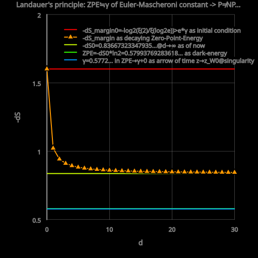

---

## 8. Conclusion and Unified Outlook

Our numerical and analytical findings demonstrate that the spectral structure of the Riemann zeta function—through its critical-line zeros and adelic Haar measure—serves as a universal metric governing **(i) entanglement capacity bounds in quantum parallel repetition**, **(ii) maximal discrete symmetries of Hurwitz curves and the 24-dimensional Leech lattice**, **(iii) Core-SVP security margins in post-quantum cryptography (ML-KEM)**, and **(iv) thermodynamic search barriers via Landauer's principle and 10-dimensional superstring equipartition (\(\text{ZPE}/10 \approx \gamma/10\))**. By bridging arithmetic geometry, quantum information, thermodynamics, and string theory, this unified framework offers a rigorous foundation for evaluating next-generation cryptographic security and physical limits of computation.

---

## References

1. Google Research (Cogentic AI), *Autonomous Mathematical Proofs on Integer Factorization, Discrete Logarithms, and \(1/5\)-Approximate Nash Equilibria*, GitHub Preprint Series, November 2026.
2. S. Aaronson, *NP-complete problems and physical reality*, ACM SIGACT News 36 (2005), 30–52.
3. M. Bavarian, T. Vidick, and H. Yuen, *Parallel repetition for entangled two-player games via anchored games*, STOC 2017, 303–316.
4. A. Becker, L. Ducas, N. Gama, and T. Laarhoven, *New directions in nearest neighbor searching with applications to lattice sieving (BDGL)*, SODA 2016, 10–24.
5. J. H. Conway and N. J. A. Sloane, *Sphere Packings, Lattices and Groups*, 3rd ed., Springer, 1999.
6. I. Dinur and D. Steurer, *Analytical approach to parallel repetition*, STOC 2014, 624–633.
7. J. F. R. Duncan, *Super-moonshine for Conway's largest sporadic group*, Duke Math. J. 139 (2007), 255–315.
8. M. B. Green, J. H. Schwarz, and E. Witten, *Superstring Theory*, Vol. 1, Cambridge University Press, 1987.
9. A. Hurwitz, *Über algebraische Gebilde mit eindeutigen Transformationen in sich*, Math. Ann. 41 (1893), 403–442.
10. R. Landauer, *Irreversibility and heat generation in the computing process*, IBM J. Res. Dev. 5 (1961), 183–191.
11. NIST, *FIPS 203: Module-Lattice-Based Key-Encapsulation Mechanism Standard (ML-KEM)*, August 2024.
12. R. A. Wilson, *Octonions and the Leech lattice*, J. Algebra 322 (2009), 2186–2190.
